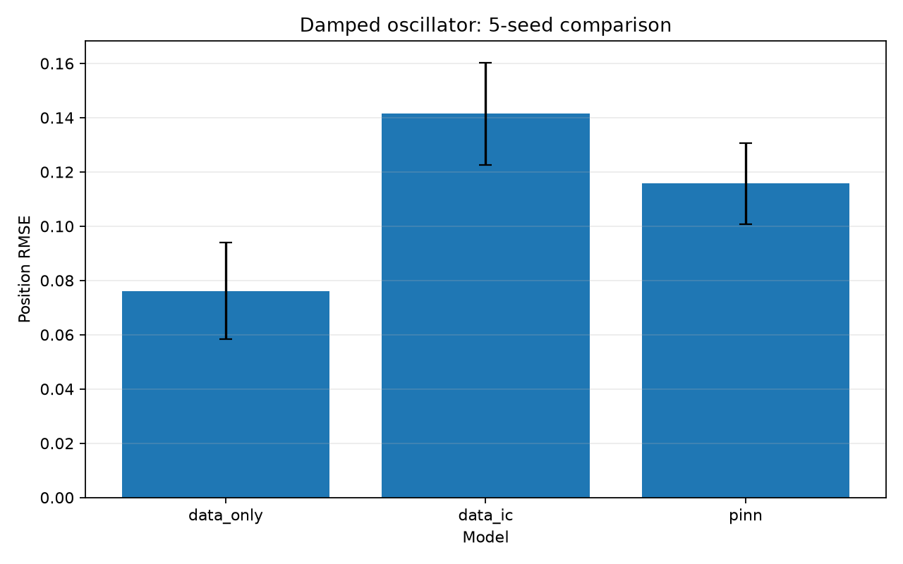

# Physics-Informed AI Lab

[](https://github.com/Taibi1234/physics-informed-ai-lab/actions/workflows/tests.yml)


**A reproducible scientific machine-learning project comparing data-driven,
initial-condition-constrained, and physics-informed neural networks on
undamped and underdamped harmonic oscillators.**

The project combines analytical mathematics, independent numerical solvers,
controlled neural-network training, multi-seed experiments, sensitivity
analysis, optimization diagnostics, and preserved research artifacts.

**[Read the final research report](reports/final_research_report.md)**



## Research questions

- Do physics-informed constraints improve trajectory prediction relative to
  data-only training?
- How does physics-loss weighting affect position error, equation residual,
  and optimization variability?
- Can a controlled experiment remain reproducible when extended from an
  undamped oscillator to an underdamped oscillator with a velocity-dependent
  residual?

## Key findings

### Undamped oscillator

- PINN training reduced equation residuals, but no tested physics weight
  dominated both position accuracy and physical consistency.
- Physics weight `10.0` achieved the lowest mean residual RMSE (`0.0297`) but
  the highest position-RMSE variability (`std=0.0313`).
- The seed-21 optimization outlier was preserved and investigated rather than
  removed from aggregate results.

### Underdamped oscillator

Five seeds, three model variants, and 15 controlled training runs:

| Model | Mean position RMSE | RMSE std. | Mean position MAE | Mean residual RMSE |
|---|---:|---:|---:|---:|
| `data_only` | **0.0762** | 0.0179 | **0.0612** | 0.1906 |
| `data_ic` | 0.1414 | 0.0188 | 0.1154 | 0.1514 |
| `pinn` | 0.1158 | **0.0150** | 0.0921 | **0.0780** |

The data-only model achieved the best trajectory accuracy, while the PINN
achieved the best physical consistency. Lower equation residual therefore did
not automatically imply lower position-prediction error.

These are descriptive results from small synthetic experiments, not evidence
of statistical significance or universal model rankings.

## Implemented capabilities

### Mathematical verification

- Undamped and underdamped analytical solutions
- Independent SciPy numerical reference solvers
- First- and second-order automatic differentiation
- Initial-position and initial-velocity verification
- Numerical-versus-analytical agreement tests
- Damped numerical reference error: `3.134079384903288e-10`

### Controlled model comparison

- Shared three-layer, 64-unit Tanh MLP
- `data_only`, `data_ic`, and `pinn` loss variants
- Seeded model initialization and observation generation
- Seeded collocation resampling
- Position RMSE, MAE, and physics-residual RMSE
- Population standard deviations across five seeds

### Research engineering

- Preserved historical weight-sweep results
- Component-level optimization-outlier diagnostics
- Raw per-run metrics and dense-grid predictions
- Machine-readable experiment configuration
- Automatically generated figures
- 19 automated tests and GitHub Actions CI
- Full research report and explicit limitations

## Project structure

```text
physics-informed-ai-lab/
├── src/physics_ai/
│   ├── data.py                  # Undamped and damped observations
│   ├── equations.py             # Analytical solutions and PINN residuals
│   ├── models.py                # Shared MLP architecture
│   └── numerical_solver.py      # Independent SciPy references
├── scripts/
│   ├── run_experiment.py        # Undamped baseline
│   ├── reproducibility_experiment.py
│   ├── diagnostic_run.py        # Seed-outlier investigation
│   ├── damped_experiment.py     # Five-seed damped comparison
│   └── generate_summary_figures.py
├── tests/                       # 19 mathematical and reproducibility tests
├── configs/                     # Preserved experiment settings
├── reports/
│   ├── final_research_report.md
│   ├── limitations.md
│   ├── diagnostics/
│   ├── weight_sweep/
│   ├── figures/
│   └── advanced_damped_oscillator/
└── .github/workflows/tests.yml